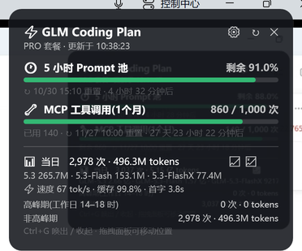
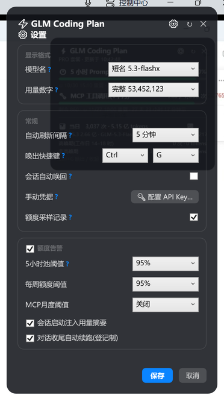
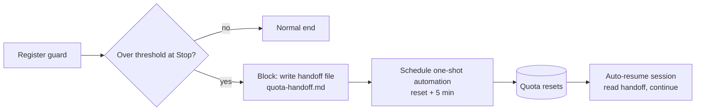

# zcode-usage-guard — 0.5.2

[中文](README.md) · English

A fork of [ssbh163/ZCode-Usage](https://github.com/ssbh163/ZCode-Usage) (MIT) that shows your **GLM Coding Plan** quota (Zhipu/Z.ai) on your desktop and keeps long unattended runs alive. Built on top of the upstream "quota query + desktop widget" base with three major additions: a **⚡ generation-speed line** (pure-decode tok/s · cache · TTFT, fully local data sources), a **⚙ grouped settings panel**, and a **quota-guard layer** (threshold alerts + unattended auto-resume).

Repo: https://github.com/COSMICAL-CONTAINER/zcode-usage-guard — upstream features are summarized at the end; the fork's additions are MIT-licensed as well.

## What the widget shows

| Row | Content |
|---|---|
| ⏱ 5-hour prompt pool | Used %, reset countdown, ⚡ burnout forecast (projected exhaustion time) |
| 📅 Weekly quota | Used %, reset time (when the plan includes one) |
| 🔧 MCP tool calls (monthly) | remaining / total (used in the sub-line), per-tool details |
| 📊 Today's usage | Calls, tokens (formattable), peak/off-peak split, per-model breakdown |
| 💹 Local vs account | Hover the footer 💹: all local calls today (ZCode's sqlite usage DB, workflow subagents included, split by provider/account) vs the official billing figure (all devices on that key, cache writes included) |
| ⚡ Speed line | Pure-decode tok/s · cache-hit rate · TTFT (Windows widget; macOS HUD not yet) |
| ⚡ Peak-hours banner | Weekdays 14:00–18:00: countdown + progress, auto-dismisses |

Progress bars fill by **remaining** quota: green → orange (≥60% used) → red (≥85% used). The `/zcode-usage-guard:usage` command and the terminal card print the same numbers.

 

## Highlights

- **Burnout forecast** — the in-progress 5-hour window is extrapolated from the last 45 minutes of samples (least squares). When it will hit 100% before reset, every surface shows "⚡ 预计 HH:mm 打满" (projected exhaustion); otherwise "窗口结束预计还剩 X%" (projected remaining at reset). Flat/idle/insufficient data → no forecast, no guessing.
- **Quota-guard: unattended auto-resume** — register a long task once; when a pool crosses the threshold at task end, the Stop hook saves progress to a self-contained handoff file and schedules a one-shot automation to resume 5 minutes after the reset. Overnight runs survive quota exhaustion with zero babysitting:



- **Usage curves** — a dark ECharts page (local read-only server on 127.0.0.1) over the sampling history: today's default view, gradient fills, reset stitching, drag/double-click to inspect any range, monthly rollup, per-model bars with API-priced estimates, forecast dashed line. Open via the 📈 button on the widget.
- **Sampling history** — every successful query appends a water-level observation (`~/.zcode/scripts/quota-samples.jsonl`). Observation-only semantics: no backfill, no interpolation, expired windows rejected. `--quota-history` prints per-cycle levels, a 7-day daily average and the burnout forecast.
- **Speed line with local data only** — pure-decode tok/s = output tokens ÷ (duration − TTFT), median over the last 10 calls, read from ZCode's own sqlite usage DB (falls back to rollout JSONL when Node < 22.5). Plus cache-hit rate and TTFT. Zero network calls.
- **Offline fallback** — if a refresh fails but a previous one succeeded, the last good data stays on screen with a "⚠ 离线 · 更新于 <original time>" badge. Never fakes fresh data.
- **⚙ Settings panel** — three bordered groups, per-item ? tooltips, model-name/token-number formats, global hotkey, refresh interval, sampling toggle, session wake toggle; the 「额度告警」 master switch locks and disables thresholds/injection/resume together.

## Install

- **Marketplace (recommended)**: ZCode → Plugins → Discover → **+** → GitHub repository → this repo → install **ZCode Usage**. If cloning fails behind a firewall, set `ZCODE_HTTP_PROXY=http://host:port` first.
- **Local directory**: download the repo, Plugins → **+** → Local directory, pick the repo root (contains `marketplace.json`).
- **Standalone scripts**: `node zcode-usage.mjs --install` (query script, `/usage` command, widget, curve page); `--uninstall` to remove (sampling history is kept as user data).

Requires ZCode desktop with a GLM Coding Plan **API key** configured in ZCode (auto-detected from ZCode's own config — zero setup). **Account-login users**: ZCode ≥3.17 stores login credentials encrypted, which the plugin cannot read — generate an API key for that account on the Zhipu open platform and paste it once via the widget's ⚙ → 🔑 manual panel. Node.js ≥ 18 (≥ 22.5 for TTFT/pure-decode speed).

## Usage

```bash
node ~/.zcode/scripts/zcode-usage.mjs            # terminal card
node ~/.zcode/scripts/zcode-usage.mjs --json     # raw JSON (includes quotaForecast)
node ~/.zcode/scripts/zcode-usage.mjs --quota-history   # cycle levels + burnout forecast
node ~/.zcode/scripts/quota-curve.mjs            # curve page (or the 📈 button)
```

In a ZCode conversation: `/zcode-usage-guard:usage`, or just ask "how much quota is left".

The Windows widget launches with ZCode (SessionStart hook), follows the ZCode theme, hotkey show/hide (default Ctrl+G), auto-recall on new sessions (toggleable), single instance, remembers position. ✕ hides; right-click → 退出 to quit. Uninstalling the plugin stops everything — no autostart leftovers.

## Performance & storage

- A full query takes ~2 s (~1.2 s of it is the official API network call; local stats cost ~40 ms). The widget refreshes in the background on a timer.
- The plugin's own data stays under 5 MB **per year**: sampling history ~11 KB/day (only while the machine is on), per-cycle ledger, auto-rotated log (512 KB cap). It reads ZCode's own sqlite/rollout stores and never copies or creates large files.

## Privacy

No keys are bundled or uploaded. Credentials are read from your local ZCode config (API-key providers; ZCode ≥3.17 account-login tokens are encrypted and out of reach — use the 🔑 manual fallback); network requests go only to official Zhipu/Z.ai endpoints (`open.bigmodel.cn` / `api.z.ai`). Speed/cache/TTFT stats read local files only — zero network.

## Inherited from upstream

API-key fallback UI with provider picker, credential auto-detection order (args → env → manual file → ZCode config, official domains only), theme following, position memory, macOS HUD (community port; the fork's speed line and settings panel are Windows-only for now). See the [upstream README](https://github.com/ssbh163/ZCode-Usage).

## Tests & changelog

```bash
node --test plugins/zcode-usage-guard/skills/zcode-usage/scripts/*.test.mjs   # 44 green
```

Full changelog in [README.md](README.md#更新日志) (Chinese).

## License

MIT — fork additions included; redistribute with upstream copyright notice intact. Thanks to [ssbh163](https://github.com/ssbh163).
