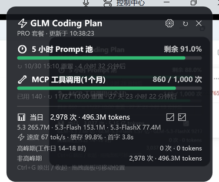
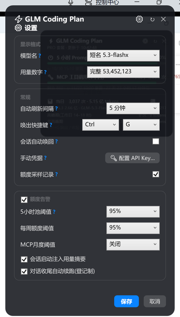

# zcode-usage-guard — 0.5.1

[中文](README.md) · [English](README.en.md)

> 在上游 [ssbh163/ZCode-Usage](https://github.com/ssbh163/ZCode-Usage)(MIT)的「GLM Coding Plan 查询 + 桌面悬浮窗」基础上,本 fork 新增三大块:
> **⚡ 生成速度行**(纯解码 tok/s · 缓存 · 首字,独立数据源)、**⚙ 分组式设置面板**(格式化选项 + 权限层级)、**额度监控与无人值守续跑(quota-guard)**。
> 本仓库:https://github.com/COSMICAL-CONTAINER/zcode-usage-guard
> 上游继承的功能在文末[「上游功能速览」](#上游功能速览)一段带过;本 fork 的新增代码同样以 **MIT** 协议发布(见文末「协议与致谢」)。

悬浮窗展示:

| 显示项 | 内容 |
|---|---|
| ⏱ 5 小时 Prompt 池 | 已用百分比、重置倒计时、⚡ 燃尽预测(预计打满时刻) |
| 📅 每周额度 | 已用百分比、重置时间(套餐含每周额度时显示) |
| 🔧 MCP 工具调用(每月) | 剩余/总量(已用见副行)、各工具明细 |
| 📊 当日用量 | 调用次数、token 消耗(格式可选)、高峰期(工作日 14–18 时)/非高峰期拆分、按模型汇总(模型名格式可选) |
| 💹 本机 / 账号对比 | 悬停底部 💹:本机当日**全部调用**(ZCode sqlite 用量库,含 workflow 子代理,按账号分列)vs 官方计费口径(该 key 全部设备,含缓存写入) |
| ⚡ 生成速度行 | 纯解码 tok/s · 缓存命中率 · 首字延迟(Windows 悬浮窗;macOS HUD 暂未包含) |
| ⚡ 高峰期提醒 | 工作日 14:00–18:00 橙色横幅常驻:剩余时长倒计时 + 时段进度条,结束自动收起 |

## 效果预览

Windows 悬浮窗(深色主题,随 ZCode 外观自动切换;v0.5.1 实拍):

| 悬浮窗:速度/缓存/首字 + 按模型用量 | ⚙ 设置面板:分组边框 + 每项 ? 说明 + 权限层级 |
|:---:|:---:|
|  |  |

macOS 为社区移植的原生 HUD(浅色;下图为上游作者的旧版截图,版式以实际编译为准——**速度行与分组设置面板目前是 Windows 版功能**,HUD 暂未同步):


进度条颜色随用量变化:绿色(充足)→ 橙色(≥60%)→ 红色(≥85%)。对话内 `/zcode-usage-guard:usage` 命令和终端卡片输出同样的数据。

## 前提条件

- [ZCode](https://zcode.z.ai) 桌面版
- 已在 ZCode 中配置智谱 Coding Plan 的 **API Key**(设置 → 模型;插件自动读取,零配置)。**账号登录用户注意**:ZCode ≥3.17 的登录凭据是加密存储,插件读不到——请到智谱开放平台给该账号生成一个 API Key,在悬浮窗 ⚙ → 手动凭据 → 🔑 里填一次即可;没配也不影响安装,查询失败时悬浮窗有一键兜底,见[上游功能速览](#上游功能速览)
- Node.js ≥ 18(终端输入 `node -v` 检查);悬浮窗速度行的「首字」与纯解码口径需 Node ≥ 22.5,不满足时自动降级(速度改用含预填充口径、首字隐藏),其余功能不受影响

## 安装

- **方式 A · 插件市场(推荐)**:ZCode 左侧栏 → 插件市场 → 发现 → 右上角 **+** → 选择 **GitHub 仓库**,填入本仓库地址 → 列表中找到 **ZCode Usage** → 获取/安装。国内网络克隆失败时,先设置环境变量 `ZCODE_HTTP_PROXY=http://host:port` 再重试(ZCode 只认这个变量,不吃普通的 http_proxy)
- **方式 B · 本地目录**:下载本仓库解压 → 插件市场 → **+** → **本地目录**,选中包含 `marketplace.json` 的仓库根目录 → 安装
- **方式 C · 只用脚本,不装插件**:下载 [zcode-usage.mjs](plugins/zcode-usage-guard/skills/zcode-usage/scripts/zcode-usage.mjs)(悬浮窗需连同 [zcode-usage-widget.ps1](plugins/zcode-usage-guard/skills/zcode-usage/scripts/zcode-usage-widget.ps1),建议直接下整个 zip),运行 `node zcode-usage.mjs --install` 一条命令装完(查询脚本、`/usage` 命令、桌面悬浮窗、登录自启,装完立即弹出);卸载 `node zcode-usage.mjs --uninstall`

## 使用

### 1. ZCode 对话内

安装插件后**新开一个对话**(命令在会话启动时加载),输入 `/zcode-usage-guard:usage`,或直接问:"查一下 Coding Plan 用量""5 小时池还剩多少""周额度什么时候重置",助手会运行脚本并整理成表格。

### 2. 终端直接运行

```bash
node ~/.zcode/scripts/zcode-usage.mjs            # 卡片式输出
node ~/.zcode/scripts/zcode-usage.mjs --json     # 原始 JSON
```

插件安装者也可以直接用插件缓存里的脚本(免 --install):

```bash
node "$(ls -d "$HOME/.zcode/cli/plugins/cache"/*/zcode-usage-guard/*/skills/zcode-usage/scripts/zcode-usage.mjs | sort -V | tail -1)"
```

### 3. 桌面悬浮窗(按设备自动选择 UI,随插件启停)

SessionStart hook 按当前设备自动选择 UI:**Windows** 为 WPF 半透明卡片,**macOS** 为原生 HUD(编译一次:进插件目录 `macos/` 执行 `bash build.sh`),其他系统无悬浮窗(仅命令/技能/注入)。**卸载插件后悬浮窗自动退出**,不残留开机自启或后台进程。

- 全局热键显示/隐藏(默认 Ctrl+G,⚙ 设置可改键);冷启动自动拉起、新会话自动唤回(唤醒文件机制,250ms 内响应;⚙ 设置「会话自动唤回」可关,跑 workflow 时建议关)、单实例去重、位置记忆
- 配色与 ZCode 外观主题保持一致(每 2 秒探测 ZCode 主窗口实际配色),不读写 Windows 主题设置;`ZCODE_WIDGET_THEME=light|dark` 可强制指定(调试用)
- 右上角 **✕** 只是隐藏(进程驻留);悬浮窗随 ZCode 退出自动关闭,需要立即结束可在任务管理器结束 powershell 进程
- API Key 失效时面板明确提示,修复后自动恢复
- 断网/查询失败时**保留上次成功数据继续显示**:状态行标注「⚠ 离线 · … · 更新于 原时间」(不冒充新数据),网络恢复后自动更新;只有从未成功查询过才显示错误页

### 4. ⚡ 生成速度/缓存/首字(本 fork 新增)

当日用量下方常驻一行:`⚡ 速度 135 tok/s · 缓存 99.5% · 首字 3.9s`。**完全独立的数据源**——直接读本机 ZCode 的使用记录(rollout 模型 I/O 日志 + sqlite 用量库),零第三方依赖、零网络请求,别的机器装完即有(无数据时该行自动隐藏)。

计算公式(全部保留,最近 10 次调用统计):

| 指标 | 公式 | 数据源 |
|---|---|---|
| 纯解码速度(展示口径) | `输出tokens ÷ ((总时长ms − 首字延迟ms) / 1000)`,取中位数 | sqlite `model_usage` |
| 含预填充速度(回退口径) | `输出tokens ÷ (总时长ms / 1000)`,取中位数 | rollout JSONL |
| 缓存命中率 | `Σ cache_read ÷ Σ input_tokens` | sqlite / JSONL |
| 首字延迟 | `median(time_to_first_token_ms)` | sqlite 独有 |

两个口径都是真的:纯解码剔除等首字的时间,反映模型真实吐字吞吐(推荐);含预填充被首字延迟摊薄,数字偏低。纯解码口径直接读 ZCode 的 sqlite 用量库——基于同一数据库的工具(如输入框下方的状态条类插件)会算出一样的数字;Node < 22.5 或库打不开时自动回退 JSONL 口径(首字隐藏),不报错。

### 5. 新会话自动注入(默认关闭)

SessionStart hook 支持在每个新对话开头注入一行额度摘要(5 小时池/每周/MCP 余量 + 重置倒计时),让模型主动感知额度。**v0.3.0 起默认关闭**——不是每个用户都希望对话被注入上下文;在悬浮窗 ⚙ 设置勾选「会话启动注入用量摘要」并保存后,下一个新会话开始生效。卸载插件即彻底停止。

### 6. ⚙ 设置面板(分组式)

点悬浮窗右上角 **⚙** 打开,三组设置各自带圆角边框,每项名字后有蓝色 **?** 悬浮说明:

| 分组 | 设置项 | 说明 |
|---|---|---|
| **显示格式** | 模型名 | 完整 `GLM-5.3-flashx` / 短名 `5.3-flashx` |
| | 用量数字 | 紧凑 `53.4M` / 完整 `53,452,123` / 中文 `5345.2 万`,全窗口统一生效 |
| **常规** | 自动刷新间隔 | 1/5/10/15/30 分钟 |
| | 唤出快捷键 | 全局热键改键(冲突自动回退;底部提示与 ✕ 悬停提示同步更新) |
| | 会话自动唤回悬浮窗 | 每次新会话/子任务开始时把悬浮窗弹到前台;工作流(多子任务)场景建议关闭,避免反复弹前 |
| | 手动凭据 | 🔑 配置 API Key 入口(自动探测失败或想手动指定服务商时使用),见[上游功能速览](#上游功能速览) |
| | 额度采样记录 | **默认关**;开启后每次查询记录额度水位——采样是历史视图与用量曲线的数据源,普通用户零写盘;点 📈 打开曲线时会自动为你开启 |
| **额度告警**(总开关) | 三池阈值 | 80/85/90/95% 或关闭;手工编辑 settings 写入的界外值(如 87%)在面板中原样保留 |
| | 会话启动注入用量摘要 | 默认关,见[上文](#5-新会话自动注入默认关闭) |
| | 对话收尾自动续跑(登记制) | Stop 钩子收尾协议,见 [quota-guard 监控层](#quota-guard-监控层本-fork-新增) |

**权限层级**:「额度告警」总开关关闭时,组内下面的阈值告警、会话注入、自动续跑**三项全部锁定且不生效**(无论各自勾选状态)——一键静默所有额度相关的主动介入;重新勾选后各按其勾选状态恢复。窗口宽度还会随模型拆分行自适应(完整模型名 + 中文数字 + 多模型叠加也不换行,上限屏幕 80%)。

以上设置持久化在 `~/.zcode/scripts/quota-guard-settings.json`(与 quota-guard 共用一份)。

## quota-guard 监控层(本 fork 新增)

### 数据面:额度状态快照

`zcode-usage.mjs` 在两种时机把额度快照**原子写入** `~/.zcode/scripts/usage-state.json`:
`--hook` 模式(每次会话启动)+ 常规模式带 `--state <path>`(悬浮窗刷新即带此参数)。
消费方一律**只读文件、不发网络请求**,hook 毫秒级返回。

```json
{
  "updatedAt": 1760000000000,
  "level": "PRO",
  "host": "open.bigmodel.cn",
  "pools": [
    { "key": "prompt5h", "label": "5小时池", "usedPct": 8.0, "resetAt": 1760000000000 },
    { "key": "mcp", "label": "MCP月度", "usedPct": 54.0, "resetAt": 1760000000000 }
  ]
}
```

### 控制面:两个 hook + 权限层级

| 事件 | 行为 | 受哪个开关管 |
|---|---|---|
| `UserPromptSubmit` | 任一池 ≥ 阈值 → 注入一行警告(默认 10 分钟节流),否则静默 | `alertsEnabled` |
| `Stop` | 已登记的会话超阈值且未布置续跑 → `{"decision":"block","reason":"<收尾协议>"}` 拦住会话,强制模型写交接文件并用 ZCode 定时自动化布置「重置 +5 分钟」的一次性续跑任务;`resume-armed.flag` 按重置周期放行,周期翻篇自动过期 | `resumeGuard` **且** `alertsEnabled` |

普通会话不登记就完全零打扰;⚙ 设置里「额度告警」总开关关闭时,上表两类介入连同会话注入一起锁定且不生效(见[设置面板](#6-⚙-设置面板分组式))。

配置(可选)`~/.zcode/scripts/quota-guard-settings.json`,`thresholds` 可按池覆盖全局阈值,
设为 `0` 表示关闭该池监控(如只想盯 5 小时池):

```json
{
  "threshold": 95,
  "thresholds": { "prompt5h": 95, "weekly": 95, "mcp": 0 },
  "warnIntervalMinutes": 10,
  "alertsEnabled": true,
  "sessionInject": false,
  "resumeGuard": true,
  "modelNameFmt": "short",
  "tokenFmt": "compact"
}
```

### 协议:无人值守续跑

skill `quota-guard` 定义交接文件格式(`~/.zcode/quota-handoff.md`,自包含——新会话看不到当前上下文)、续跑任务布置步骤、唤醒复查流程。长任务(如凌晨无人值守)在额度触及阈值时优雅收尾,重置后 5 分钟自动恢复,长期无人值守。

```mermaid
flowchart LR
    A[长任务登记守卫] --> B{Stop 时额度超阈值?}
    B -- 否 --> C[正常收尾,零打扰]
    B -- 是 --> D[拦截收尾:写交接文件<br/>quota-handoff.md<br/>(自包含,含进度/下一步)]
    D --> E[布置定时自动化<br/>重置时刻 +5 分钟]
    E --> F[(额度重置)]
    F --> G[自动唤醒会话<br/>读交接文件继续未完成任务]
    G --> H{还有额度?}
    H -- 是 --> I[任务继续/完成]
    H -- 否 --> D
```

### 测试

```bash
node --test plugins/zcode-usage-guard/skills/zcode-usage/scripts/*.test.mjs
```

## 额度采样历史(0.4.0)

与上面的周期消费台账(`usage-history.jsonl`,记"每周期用了多少量")互补,采样历史记"**额度水位怎么走的**":开启 ⚙ 设置的「额度采样记录」后,悬浮窗刷新与手动 CLI 的每次成功查询都会自动追加一条水位观测到 `~/.zcode/scripts/quota-samples.jsonl`(SessionStart hook 仅在勾选「会话启动注入用量摘要」时采样):

```json
{"at":1760000000000,"resetAt":1760017800000,"usedPct":35,"level":"PRO","host":"open.bigmodel.cn"}
```

**数据语义**(务必保持的守则):只记观测事实,不回填不插值;过期窗口(重置时间已过的旧响应)拒绝入库;同刻去重;**周期最终使用率未知**(末次水位是下界,顶格 100% 的周期真实消耗可能更高);悬浮窗/插件没在跑的时段就是没有采样。

查询入口(均纯本地读、无需凭据、不发网络请求):

```bash
node ~/.zcode/scripts/zcode-usage.mjs --quota-history        # 最近 8 个周期水位 + 近 7 天窗口末次水位 + ⚡ 燃尽预测
node ~/.zcode/scripts/zcode-usage.mjs --quota-history 20     # 看更多周期(上限 60)
node ~/.zcode/scripts/zcode-usage.mjs --export-quota-csv out.csv   # 逐次采样 CSV(北京时间列)
```

"窗口末次水位"口径:一天约 4.8 个五小时窗口,取各窗口末次已用百分比按日平均(如五个窗口各用了一半 → 当天 50%);/usage 汇总行按窗口加权。展示口径为本插件新增,已经过全量真实历史逐日交叉验证。`/zcode-usage-guard:usage` 与终端卡片输出的尾部也会自动带上近 7 天均值一行(有数据时);`--samples <path>` 可重定向存储位置(测试/调试用);`--uninstall` 会保留采样文件(用户数据)。

## 用量曲线(0.5.0,曲线全家桶)

```bash
node ~/.zcode/scripts/quota-curve.mjs     # 打开曲线窗口(Edge/Chrome 应用窗口,无地址栏)
```

也可点悬浮窗当日行的 **📈 按钮** 一键打开。曲线页面(暗色 ECharts 全家桶):

- **今日默认视图**(今天首个五小时周期 → 现在,一般四五条曲线),切片「今日/全部/近 N 天/自定义」
- **⚡ 燃尽预测虚线**:进行中的窗口按最近 45 分钟消耗速度最小二乘外推,末端标注「预计 HH:mm 打满」或「预计剩 X%」;消耗停滞/数据不足时不画,不硬凑
- 线色随剩余量**绿→黄→红**、曲线下方**渐隐填充**、重置边界**虚线衔接**、停机断线不补造
- **拖选/双击曲线/点卡片**看任意时段(含进行中周期),**「月」按月汇总**,缩放视图跨自动刷新保持
- 模型用量柱状图 + **API 估价**(悬停金额看逐模型计算公式)——经本机服务代理官方接口(30s 节流),无凭据时曲线照常、该面板为空
- 服务只绑定 127.0.0.1(只读),闲置 10 分钟自动退出;**单实例**(再运行直接再开一窗);支持 `--port/--samples/--idle/--no-open` 参数(见源码头注释)

数据源就是上面的采样历史:「额度采样记录」**默认关**(普通用户零写盘)——未开启时点击 📈 会**自动开启并落盘**后打开页面(自愈式);也可在 ⚙ 设置里开启。

## 上游功能速览

继承自上游 [ssbh163/ZCode-Usage](https://github.com/ssbh163/ZCode-Usage) 的功能,一段带过;完整文档见[上游 README](https://github.com/ssbh163/ZCode-Usage)。

- **三个查询入口**:对话内命令(见上)、终端 CLI(见上)、桌面悬浮窗(见上);三端数据口径一致
- **API Key 兜底**:自动探测失败时,Windows/macOS 悬浮窗失败页点 **🔑 配置 API Key**,面板内选服务商(智谱开放平台/智谱国际)+ 粘贴 Key,存 `~/.zcode/zcode-usage-manual.json`(三端共用;Key 不回显、走环境变量传递不出现在命令行);「清除已存 Key」可恢复自动探测
- **自动探测顺序**:运行参数 `--key/--base` → 环境变量 `ANTHROPIC_AUTH_TOKEN`(+`ANTHROPIC_BASE_URL`;只设 `ZAI_API_KEY` 时默认国际站)→ 手动配置文件 → ZCode 配置 `~/.zcode/v2/config.json`(扫描全部已启用 provider,只认 `open.bigmodel.cn` / `api.z.ai` 两个官方域名,主动跳过没有监控接口的启动版域名 `zcode.z.ai`)。**边界**:ZCode ≥3.17 的「账号登录」provider(`account:*`)凭据加密存于 `credentials.json`,不在扫描范围——这类用户请在 🔑 手动配置里填该账号的 API Key
- **悬浮窗体验**:深浅主题跟随 ZCode、位置记忆、单实例唤回、热键收起(详见[使用](#使用))

> 上述功能的完整文档见[上游 README](https://github.com/ssbh163/ZCode-Usage)。

## 隐私与安全

- 插件**不含任何密钥**。脚本运行时从本机 ZCode 配置(`~/.zcode/v2/config.json`)读取你自己的 API Key
- 网络请求只发往智谱官方域名(`open.bigmodel.cn` / `api.z.ai`),查询走官方监控接口,不消耗 prompt 额度
- 速度/缓存/首字统计完全读本机文件,不发起任何网络请求

## 性能与存储

- **查询耗时**:完整查询约 2 秒(官方 API 网络 ~1.2s 为大头,本地统计仅 ~40ms);悬浮窗后台定时刷新,不占前台;断网时有上次数据兜底(见上文)
- **磁盘占用**:插件自身数据一年不到 5 MB——采样历史 ~11 KB/天(开机才记录,挂机不增长)、周期台账按周期追加、日志自动轮转(512 KB 上限);只读复用 ZCode 自身的用量库与 rollout 日志,**不复制、不产生大文件**

## 常见问题

**Q:提示"未找到 Coding Plan API Key"?**
最省事:点悬浮窗失败页的 **🔑 配置 API Key** 手动填写;或先在 ZCode 设置里配好智谱 Coding Plan 的 API Key;或设置环境变量 `ANTHROPIC_AUTH_TOKEN` + `ANTHROPIC_BASE_URL`,或运行时传 `--key <apiKey> --base <baseURL>`。
如果你在 ZCode 里是用**账号登录**(而非 API Key)——新版 ZCode 的登录凭据加密存储,插件读不到——请到智谱开放平台给该账号生成 API Key 后按上面方式手动填写一次即可。

**Q:换了账号/套餐,为什么悬浮窗还是旧号的数字?**
插件一次只查探测到的那个 key,且采样/曲线没有账号身份字段(多账号支持暂未做)。换号后下一轮刷新会自动跟随新号;想立刻切换或两个号都看,用 🔑 手动配置填对应号的 Key 最直接。

**Q:HTTP 401?**
API Key 无效或过期,去智谱开放平台重新获取。

**Q:悬浮窗热键没反应?**
①进程没在运行(它只随 ZCode 存活;重开 ZCode 或新开一个对话即恢复);②热键被其他软件占用(截图/翻译工具等)——保存改键时面板会提示"已被占用,已保留原键",关闭占用软件后在 ⚙ 设置 → 常规 → 唤出快捷键换一个键(保存即生效)。

**Q:额度数字和网页后台对不上?**
查询接口是智谱未公开文档的监控接口,官方若调整字段,更新脚本中的映射即可(`TOKENS_LIMIT` unit=3 是 5 小时池、unit=6 是每周,`TIME_LIMIT` 是 MCP 每月)。

## 目录结构

```
zcode-usage-plugin/                       ← 市场仓库根目录
├── .zcode-plugin/marketplace.json      ← 市场清单
├── marketplace.json                    ← 本地目录安装(方式 B)读取的市场清单;与 .zcode-plugin 版内容有差异,各自供不同安装路径
└── plugins/zcode-usage-guard/                ← 插件本体
    ├── .zcode-plugin/plugin.json
    ├── hooks/hooks.json                ← SessionStart 拉起悬浮窗;SessionStart/UserPromptSubmit/Stop 组成 quota-guard 监控层(见下)
    ├── commands/usage.md               ← /zcode-usage-guard:usage 命令
    ├── macos/                          ← macOS 原生悬浮窗(ZCodeUsageHUD.swift + build.sh)
    └── skills/zcode-usage/
        ├── SKILL.md
        └── scripts/
            ├── zcode-usage.mjs           ← 查询脚本(零依赖,支持 --install/--uninstall)
            ├── zcode-usage-widget.ps1    ← Windows 悬浮窗(半透明卡片)
            ├── widget-launch.mjs       ← 跨平台启动器(按设备分发;新会话 touch 唤醒文件唤回已有实例)
            ├── widget-launch.vbs       ← Windows 启动器(vbs,免黑窗)
            ├── quota-curve.mjs         ← 用量曲线服务+窗口(0.5.0,曲线全家桶)
            ├── curve.html              ← 曲线页面
            ├── echarts.min.js          ← 离线 ECharts 5.6.0(Apache-2.0,~1MB)
            └── *.test.mjs              ← 四个测试文件(node --test)
```

## 卸载

**插件方式**(推荐,卸载即全清):ZCode 设置 → 插件管理 → 已安装 → ZCode Usage → 卸载。悬浮窗会在数秒内检测到插件缓存被移除而自动退出,会话注入同时停止,不残留开机自启、进程或配置。

**独立脚本方式**(曾运行过 `--install` 的用户):`node zcode-usage.mjs --uninstall`,一键清除悬浮窗进程、开机自启、`~/.zcode/scripts/` 下的脚本、`/usage` 命令、cli 配置中的 hook。

## 更新日志

- **0.5.1**:修复版(修 bug 为主,无新依赖)。**采样开关根因修复**:上游 0.5.0 的「额度采样记录」勾选框漏了控件绑定——勾了不生效、保存恒写回关、重启即"丢配置",本次补上;开关拨动即落盘(不再依赖保存按钮)。⚙ 面板:点「取消」按打开时的可见性快照恢复主界面(此前取消后整窗空白);「会话自动唤回」行与「手动凭据」行拆开各自独立;🔑 配置表单打开时自动收起设置面板;保存/取消不再卡顿两三秒;新增「会话自动唤回悬浮窗」开关(默认开,跑 workflow 多子任务时可关)。**断网兜底**:查询失败时保留上次成功数据继续显示,状态行标注「⚠ 离线 · 更新于 原时间」(不冒充新数据),网络恢复自动更新;仅冷启动后从未成功过才显示错误页。**MCP 行口径与进度条**:主数值改「剩余 860 / 1,000 次」(已用移副行,三端统一);已用比例不再信服务端滞后的 percentage 字段(实测次数 140 而百分比仍 9),改为次数自算并在查询源头归一化——快照 usedPct、会话注入行、CLI 卡片进度条一并修复;进度条基准宽度实时量取(写死常数在自适应宽度/高 DPI 下虚高约 7%,曾把 98% 剩余画成全满)。README 截图更新至 0.5.1 实拍;新增 **⚡ 燃尽预测**:采样数据对进行中的五小时窗口按最近 45 分钟消耗速度外推,窗口内会打满时悬浮窗/CLI 卡片/曲线页(预测虚线)/`--quota-history` 四端显示「预计 HH:mm 打满」,打不满显示「窗口结束预计还剩 X%」(停滞或数据不足不显示,不硬凑);新增 forecastWindow 测试 6 用例。曲线页预测体验三连修:预测虚线纳入默认视图(轴右缘随预测延伸,不必手动缩小)、打满标注显示时刻而非日期、预测线插值为可悬停数据点(任意未来时刻的预计剩余);预测末端圆点从 markPoint 拆为独立 scatter,消除 tooltip 同名双行。quota-guard 会话解析改为显式 --session 优先于环境变量(ZCode 3.17.2 起注入 CLAUDE_SESSION_ID 曾致测试连挂)。**💹 本机/账号对比换 sqlite 全量账本**:原 rollout 数据源漏记 workflow 子代理(实测仅 4% 覆盖),换源后本机/账号比值 4% → 33%,并新增「本机按账号」分列(多账号消耗本机视角可见);README 修正凭据表述(API Key 零配置;账号登录加密不可读,需手动填 Key)、新增性能与存储说明。全套 43 测试绿。
- **0.5.0**:📈 用量曲线全家桶(quota-curve.mjs + curve.html + 离线 echarts.min.js):ECharts 曲线页——今日默认视图/渐变线与渐隐填充/重置衔接/拖选与双击选周期/月视图/悬停公式/API 估价;只读本地服务仅绑 127.0.0.1、30s 节流代理模型接口、闲置 10 分钟退出、单实例;入口:CLI、悬浮窗当日行 📈 按钮、/usage 命令说明;⚙ 设置新增「额度采样记录」checkbox(默认关,普通用户零写盘);`--install` 同步安装曲线三件套,`--uninstall` 清理(采样历史保留)。新增 quota-curve.test.mjs(3 用例,全套 36 绿);已用真实 15 天历史数据验证渲染。
- **0.4.0**:📈 额度采样历史:每次成功查询自动追加一条五小时池水位观测到 `~/.zcode/scripts/quota-samples.jsonl`(过期窗口拒绝、同刻去重、观测口径、最终使用率未知);新增 `--quota-history [N]`(周期水位 + 近 7 天窗口末次水位)与 `--export-quota-csv`(逐次采样 CSV)两个纯本地视图;`/usage` 与终端卡片尾部自动附"近 7 天窗口平均水位"一行(观测下界);与既有周期台账(usage-history.jsonl)互补——台账记用量、采样记水位。新增 quota-samples.test.mjs(8 用例);
- **0.3.0**:⚡ 生成速度行(速度/缓存/首字,独立数据源:本机 rollout 日志 + ZCode sqlite 用量库,展示纯解码口径,公式见 README)——此前先短暂依赖过 api-quota 插件的本地服务,0.3.0 起完全独立。⚙ 设置面板重做:三组圆角边框分组、每项 ? 悬浮说明、模型名(完整/短名)与用量数字(紧凑/完整/中文)格式化下拉、额度告警总开关联动锁定(总开关关闭时组内阈值/注入/续跑全部锁定且不生效,含 guard 与 hook 侧的实际行为)、会话注入默认关闭、新增「对话收尾自动续跑」总开关。悬浮窗宽度随模型拆分行自适应(上限屏幕 80%,超出右缘自动左移);设置/配置视图收起速度行;修复改键后底部提示不更新与提示缺少修饰键(单元素 Where-Object 结果按数组索引)两个显示 bug;token 数字格式化参数化。README 重构:本 fork 功能为主体,上游功能压缩速览。
- **0.2.0 – 0.2.2**:改名 zcode-usage-guard;看门狗协议 v2(登记制);周期用量历史;⚙ 设置面板初版与每池阈值 toast;💹 本机/账号对比弹窗;悬浮窗多项修复与用户反馈三项修复。详见提交历史。
- **0.0.1 – 0.0.6(上游时期)**:唤回机制、双主题跟随、API Key 手动配置兜底、高峰拆分算法修正等,详见提交历史与上游仓库。

## License

MIT

---

## 协议与致谢

本仓库延续上游 **MIT License**(`LICENSE`,Copyright (c) 2026 glm-usage contributors);
本 fork 新增的代码(⚡ 速度行、quota-guard 钩子、额度状态快照、⚙ 设置面板、无人值守续跑协议)同样以 **MIT** 发布。
二次分发请一并保留上游版权声明与本声明。致谢上游作者 [ssbh163](https://github.com/ssbh163)。
